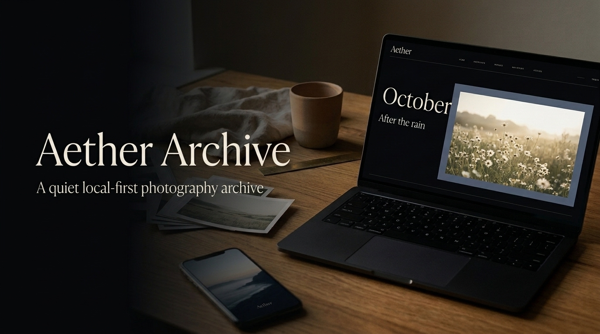
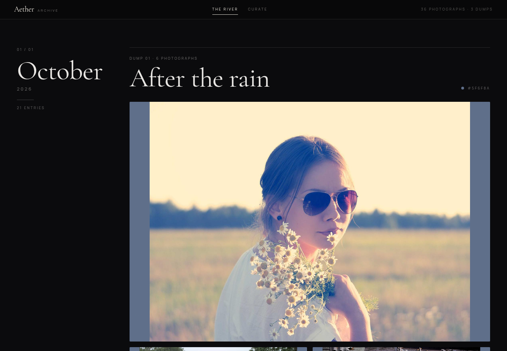
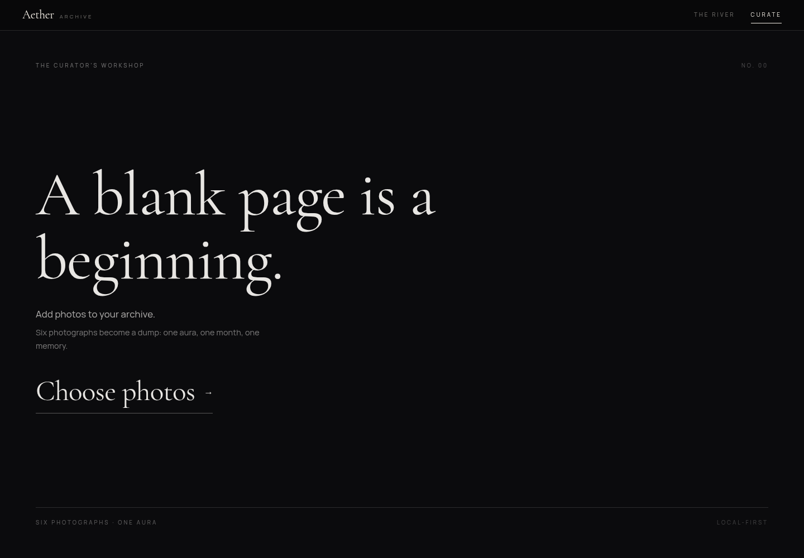
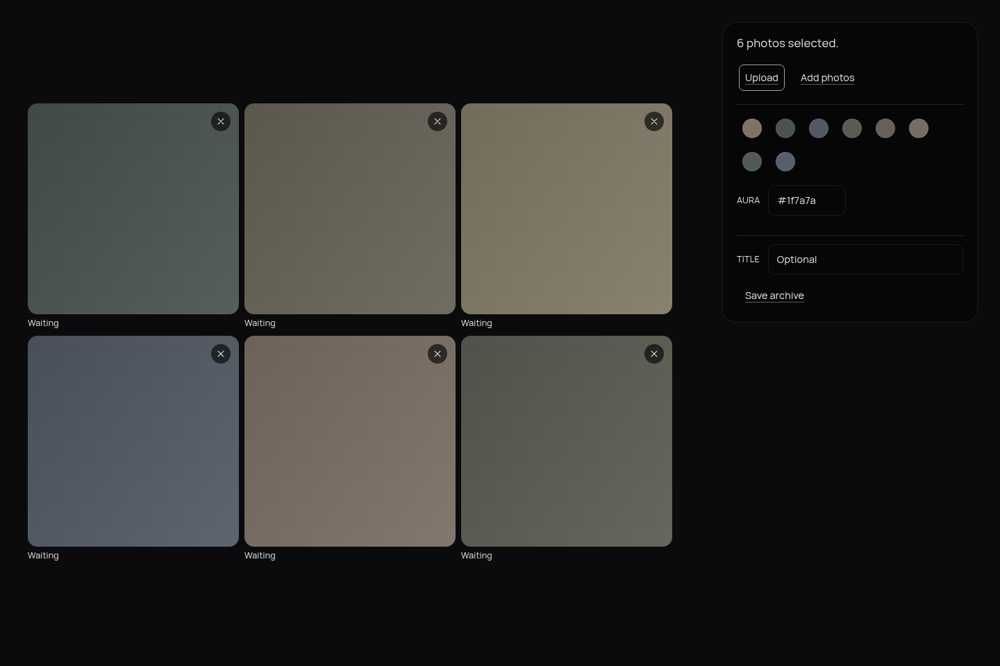
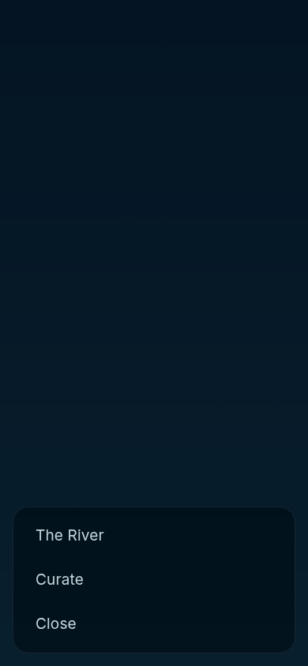
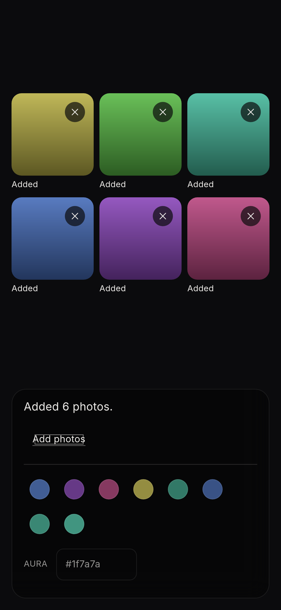
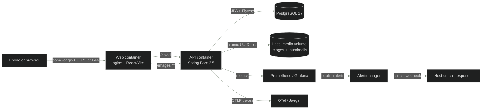

<center>



# Aether Archive

**A quiet local-first photography archive for the images worth returning to.**

[](https://github.com/ACADEMIC-AND-PERSONAL-PROJECTS/Aether-Archive/actions/workflows/ci.yml)

`React 19` · `Vite 8` · `TypeScript 6` · `Spring Boot 3.5` · `Java 21` · `PostgreSQL 17`

</center>

Aether Archive turns an endless camera roll into a deliberate ritual: open one image, move through a
calm chronological river, curate six photographs, choose the aura, and publish a monthly dump. The
archive is the object; the interface is the frame.

**Live demo:** [168.138.70.166.nip.io](https://168.138.70.166.nip.io) · **Course project:** DataTalksClub
AI Dev Tools Zoomcamp · **Release:** [v1.0.0](https://github.com/ACADEMIC-AND-PERSONAL-PROJECTS/Aether-Archive/releases/tag/v1.0.0)

## Demo

<center>

<video src="https://github.com/user-attachments/assets/8737d617-8312-4994-9c6c-dd50a4b605a8" width="820" controls playsinline preload="metadata"></video>

**Brand film — 44 seconds**

Pure motion design in the archive's ink-and-paper language: kinetic type, aura fields, six memory
cards, local-first geometry and the final brand lockup. No screenshots. No audio.

</center>

<details>
<summary><b>Watch the product film built from the real application</b></summary>

<center>

<video src="https://github.com/user-attachments/assets/e70f6351-10c4-4a84-9b96-bda5eb4dadc7" width="720" controls playsinline preload="metadata"></video>

36-second silent product film using the River, Workshop and observability evidence captures.

</center>

</details>

<center>
<sub>Both films are rendered with Remotion and published as release assets, so GitHub can play them without adding video binaries to the repository.</sub>
</center>

## The problem

Personal photos accumulate faster than anyone curates them. Camera rolls are streams; cloud galleries
are built for storage, sharing and engagement. Neither creates a private, quiet reason to look again at
the photographs you actually love.

The result is an archive you never revisit — and the monthly six-photo dump that never gets made.

## What Aether Archive does

| Experience | What happens |
| --- | --- |
| **Splash** | One full-bleed photograph, no visible chrome. Tap for the menu; pull down for another image. |
| **The River** | A chronological archive grouped by month, where photographs and six-image dumps become editorial spreads. |
| **The Workshop** | Add up to six photos, reorder them, inspect the extracted aura, title the dump and publish it. |
| **Local-first by design** | No account, feed, likes, recommendation engine or third-party runtime request. |

The ritual is deliberately small: **open → look → curate → publish → return to the River.**

## The product

<center>

</center>

<details>
<summary><b>See the Workshop and the visual system</b></summary>

<center>

<br><br>

</center>

</details>

<details>
<summary><b>See the mobile ritual</b></summary>

<center>

<br><br>

</center>

</details>

## Why it feels different

- **Photography first** — full-bleed images, almost invisible chrome and one focal point per view.
- **Image-derived colour** — the palette is extracted locally from the user's photographs in OKLCH and
  becomes the page aura.
- **Six-photo ritual** — a dump has exactly six ordered photographs, not an infinite feed.
- **Editorial motion** — fades, drifts and interruptible transitions; no attention-seeking loops.
- **Private by default** — local filesystem storage, PostgreSQL metadata, no cloud dependency in the
  default profile and no analytics.
- **Honest operations** — the public demo has self-hosted metrics, traces, logs, alerts and a host-side
  on-call responder, without photo content or PII in telemetry.

## Quick start

### One-command stack

```bash
git clone https://github.com/ACADEMIC-AND-PERSONAL-PROJECTS/Aether-Archive.git
cd Aether-Archive
cp .env.example .env
docker compose up -d --build
```

Open [http://localhost:3000](http://localhost:3000).

Seed the photographic demo with 36 attributed photos and three six-picture dumps:

```bash
make demo
```

Stop the stack without deleting data:

```bash
docker compose down
```

`make clean` is the explicit destructive reset for the named PostgreSQL and media volumes.

### Development mode

```bash
docker compose -f docker-compose.dev.yml up -d
(cd backend && ./mvnw spring-boot:run)
(cd frontend && npm install && npm run dev)
```

The Vite development server runs on `:5173`; the container stack serves the finished application on
`:3000`. Both keep the API and image routes same-origin to the browser.

## Stack

| Layer | Arsenal |
| --- | --- |
| Frontend | React 19.3.1 · Vite 8.3.4 · TypeScript 6.0.3 · Tailwind CSS 4.3.3 · TanStack Query 5.104.3 · `@dnd-kit` |
| Typography | Cormorant Garamond · Manrope Variable · Fontsource packages, bundled locally |
| Backend | Java 21 · Spring Boot 3.5.16 · Spring Web · Spring Validation · Spring Data JPA |
| Persistence | PostgreSQL 17 · Flyway · UUID domain model · optimistic-safe service rules |
| Storage | Local filesystem · atomic writes · UUID filenames · canonical path guards |
| Delivery | Docker Compose · nginx · Caddy · GHCR · GitHub Actions · release/deploy/rollback scripts |
| Signals | Actuator · Micrometer Prometheus · OpenTelemetry · Grafana · Loki · Alertmanager · Jaeger |
| Quality | JUnit 5 · Testcontainers · Vitest · React Testing Library · Playwright · axe-core · ESLint · Prettier |

## Architecture



The default profile is local-first and telemetry-free. The public demo is a separate seeded deployment
profile: operational signals only, no image content, no filenames and no personal archive data.

## API

The canonical contract lives in [`_docs/openapi.yml`](_docs/openapi.yml).

| Method | Endpoint | Purpose |
| --- | --- | --- |
| `GET` | `/api/v1/photos` | Read the chronological photo river |
| `POST` | `/api/v1/photos` | Upload one validated image |
| `GET` | `/api/v1/photos/random` | Select the Splash photograph |
| `GET` | `/api/v1/dumps` | Read monthly six-photo dumps |
| `POST` | `/api/v1/dumps` | Publish exactly six ordered photos and an aura |
| `GET` | `/images/**` | Serve files from the configured data directory |

Errors use RFC 9457 `ProblemDetail` responses with stable error codes. The server remains authoritative
for upload validation, path safety, dump cardinality and ordering.

## Observability and on-call

The production-shaped profile demonstrates the complete publish journey:

1. The browser starts a W3C trace context when publishing a dump.
2. Spring Boot continues the trace through validation, storage and SQL.
3. Prometheus records request outcomes and latency histograms.
4. Alertmanager pages the host responder when the publish journey fails.
5. The responder diagnoses Docker health, restarts only the required service and records the incident.

Evidence is documented in [`docs/engineering/OBSERVABILITY.md`](docs/engineering/OBSERVABILITY.md) and
[`reports/observability-incident-drill-20261022.md`](reports/observability-incident-drill-20261022.md).

## Verification

```bash
make verify
```

The latest recorded gate completed with:

- **307 backend tests** with PostgreSQL Testcontainers
- **518 frontend tests**
- **27 on-call unit tests**
- ESLint, Prettier, TypeScript and production build passing
- Playwright + axe contrast gate passing at 320, 768 and 1280 pixels
- shell syntax and Compose configuration checks passing

See [`reports/verify-final-20261022.md`](reports/verify-final-20261022.md) for the evidence ledger.

## Project map

```text
backend/       Spring Boot REST API, services, persistence and storage
frontend/      React/Vite application and editorial design system
release assets  Product film and pure-motion brand film
observability/ Prometheus, Grafana, Loki, Alertmanager and OTel configuration
oncall/        Host-side incident responder and runbook
scripts/       Demo seeding, smoke checks, deployment, backup and rollback
docs/          Architecture, design system, course evidence and Scrum records
reports/       Verification, security, observability and deployment evidence
_docs/         Canonical product specification and OpenAPI contract
```

## Documentation

- [Final project evidence](docs/course/FINAL-PROJECT.md)
- [Architecture](docs/engineering/ARCHITECTURE.md)
- [Design system](docs/engineering/DESIGN-SYSTEM.md)
- [Deployment](docs/engineering/DEPLOYMENT.md)
- [Observability and runbook](docs/engineering/OBSERVABILITY.md)
- [Agent team](docs/agents/TEAM.md)
- [Product backlog](docs/scrum/PRODUCT-BACKLOG.md)
- [Decision log](docs/scrum/DECISION-LOG.md)

## Status

The four product views — Splash, Menu, River and Workshop — are complete and redesigned as an editorial
print object. The course slice adds the containerized stack, public demo profile, CI/CD with GHCR,
self-hosted observability, publish alerting, host on-call and deployment rollback.

Known frontend findings remain tracked in GitHub issues [#176](https://github.com/ACADEMIC-AND-PERSONAL-PROJECTS/Aether-Archive/issues/176),
[#177](https://github.com/ACADEMIC-AND-PERSONAL-PROJECTS/Aether-Archive/issues/177),
[#179](https://github.com/ACADEMIC-AND-PERSONAL-PROJECTS/Aether-Archive/issues/179) and
[#189](https://github.com/ACADEMIC-AND-PERSONAL-PROJECTS/Aether-Archive/issues/189).

## License

Personal project. No license granted.

<center>

**Aether Archive — the calm after the scroll.**

Built with ink, photographs and a very deliberate amount of software.

</center>
