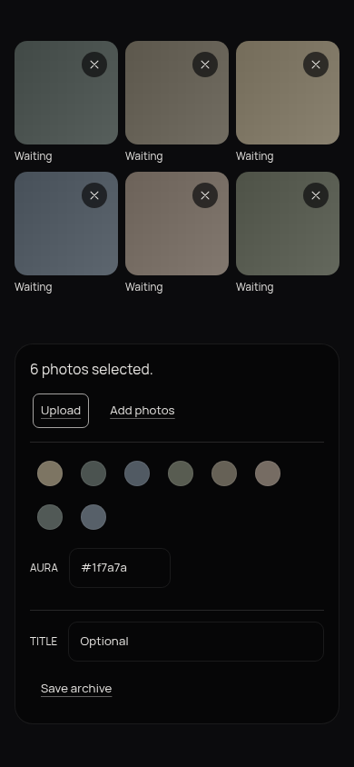

# Verification — E6-S26 / #178

**Branch**: `feature/e6-s26-editorial-glass-redesign` · **Verified**: 2026-10-19
**Verdict**: **PASS WITH LIMITATIONS** — all four views and responsive layouts passed Chromium checks; an initial River scroll-memory failure was fixed and independently re-tested. Physical iOS/Android and full photo-variation checks remain outstanding.

## Scope and evidence

Canonical `_docs/aether_archive_specs.md` stayed unchanged. Chromium 152 tested the running LAN dev app (`http://192.168.1.10:5173`) with a temporary demo API at 390×844, 1440×960, and 320×700. No external HTTP requests, console/page errors, or failed requests were observed in the passing dev run.

| Check | Result and evidence |
|---|---|
| Routes and responsive fit | `/`, `/river`, `/curate`, `/check` returned 200 at all three sizes; no horizontal overflow. |
| Splash and menu | Full-bleed, text-free splash; menu opened on demand. Escape closed it and returned focus; Tab wrapped; touch-emulated River navigation worked. Menu rows measured 64 px. |
| River layout and aura | River `main` stayed bounded (`844/5010`, `960/8496`, `700/4155` client/scroll heights). The visible `#eb6a6a` dump changed `--aura-bg` to `rgb(235, 106, 106)` and it reset after leaving. |
| River scroll memory | Regression test failed before the fix (expected 640, got 0). Afterward, Chromium navigated away and back at 390×844 and 1440×960; `main.scrollTop=1300` restored in a new River element at both sizes. |
| Workshop | Six synthetic photos rendered on phone and desktop; remove, Upload, Add photos, Aura, Title and Save archive controls remained visible. Empty file and invalid aura validation displayed their error states. No upload or publish was sent during QA. |
| Accessibility and palette | Menu focus path and reduced-motion behavior passed. `/check?theme=demo` reported contrast ratios 14.85:1, 13.87:1, 15.61:1, 6.18:1, 5.16:1 — all passed. |
| Frontend gates | `npm run lint`, `npm run test -- --run` (**43 files / 513 tests**), `npm run typecheck`, and `npm run build` passed. Existing jsdom canvas `getContext()` notices were non-failing. Backend `./mvnw -q -B verify`: **307 tests passed**. |
| Local fonts | Production build emitted five Cormorant Garamond/Manrope files totaling **133,376 bytes** (under 200 KB). Both fonts loaded in Chromium; dev run had zero off-origin requests. |

The scroll regression came from passive-effect cleanup reading a detached scroller as `scrollTop=0` and overwriting the saved value. `useLayoutEffect` now captures the final position before detachment; a route-remount regression test covers it. The follow-up browser check measured the actual internal scroller and aura after navigation.

## Limitations

- No physical iOS Safari or Android Chrome device was available; viewport/touch emulation is not a device pass.
- Standalone Vite production preview has no API proxy; its `/api/v1` requests returned 401. The LAN dev app with the demo backend passed.
- The complete pale, dark, colorful, busy and monochrome photo matrix was not forced through every view.

Screenshots use synthetic images, not archive content:

## Design principles and sources

1. Preserve the spec's image-first hierarchy and zero-chrome splash.
2. Recompose for screen size; do not stretch the phone layout.
3. Keep glass over real imagery, with contrast and a solid fallback.
4. Bound fluid sizing and retain whitespace around photos.

Sources: [Apple HIG — Layout](https://developer.apple.com/design/human-interface-guidelines/layout) · [MDN — `backdrop-filter`](https://developer.mozilla.org/en-US/docs/Web/CSS/backdrop-filter) · [web.dev — CSS sizing functions](https://web.dev/articles/min-max-clamp) · [Site Builder Report — Photography portfolios](https://www.sitebuilderreport.com/inspiration/photography-portfolios). References informed principles; no assets or layouts were copied. Final staged diff (`git diff --cached --numstat HEAD`): 18 files, 320 additions / 91 deletions (411 text lines); 395 hand-written changed lines, excluding generated `frontend/package-lock.json` (+8/−8). The two attached PNG screenshots are binary assets and are not counted as text lines.
